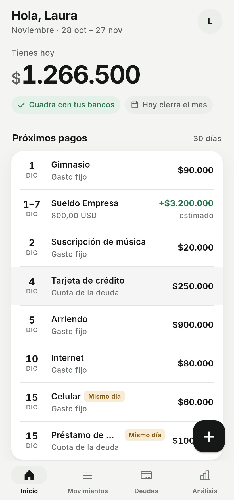
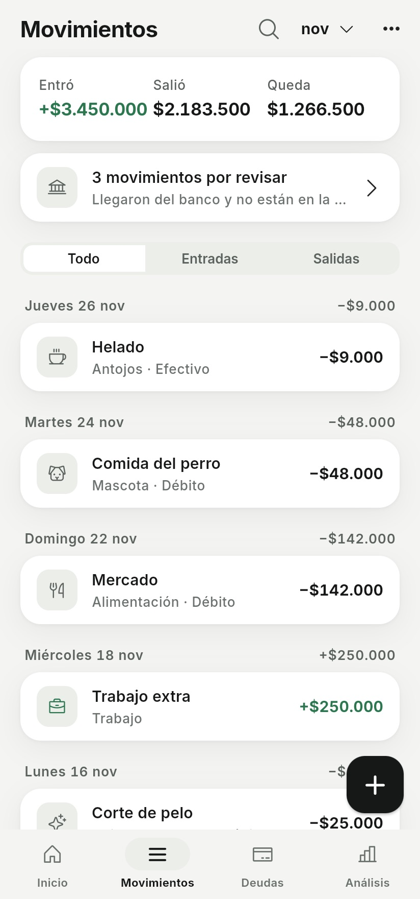
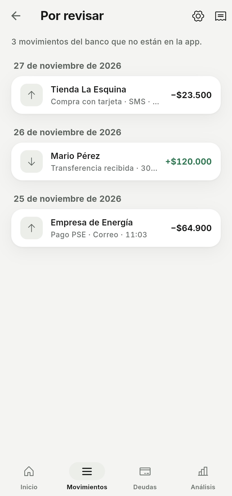
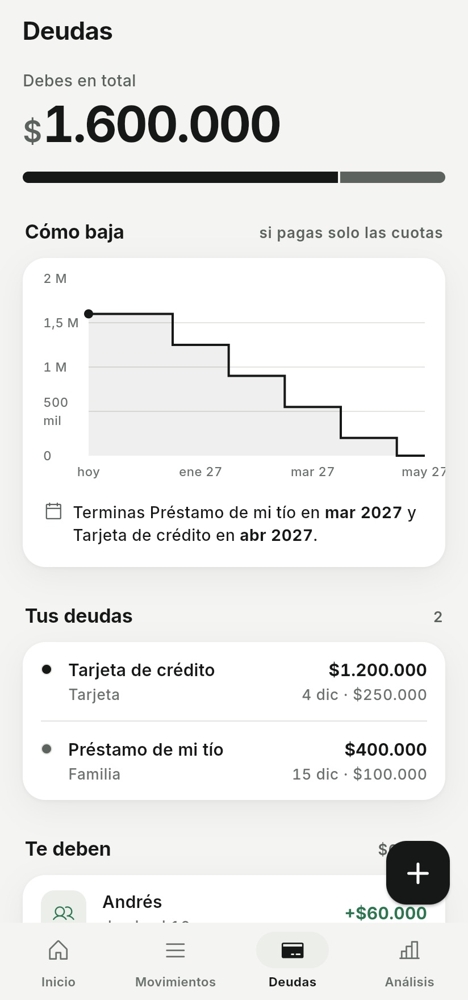
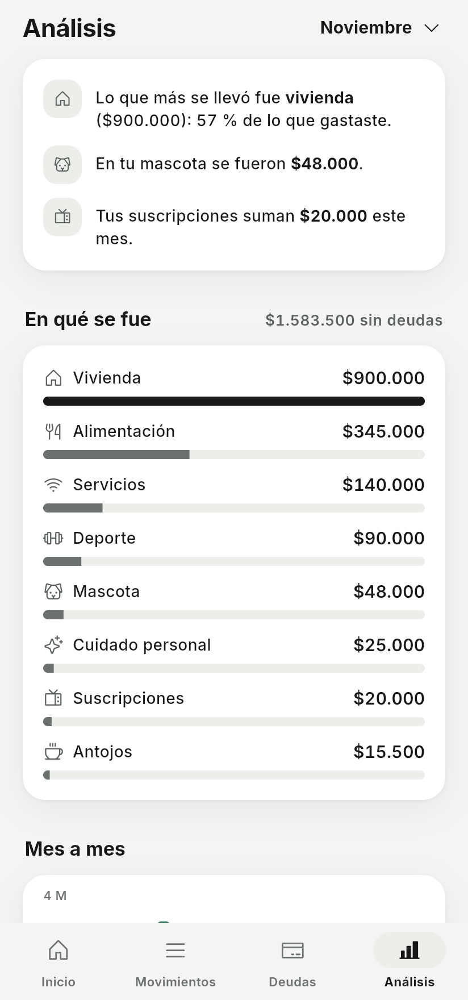
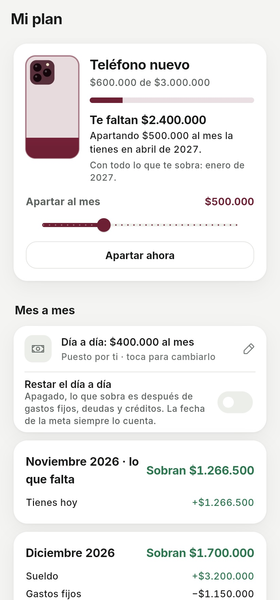

# Calculadora de Gastos

Aplicación personal de finanzas para el día a día: cuánto hay hoy, qué toca pagar pronto, en
qué se va el dinero, cómo bajan las deudas y cuánto sobra del sueldo para cumplir una meta. Los
movimientos que avisa el banco llegan solos a una bandeja para revisarlos.

Disponible en **web**, **Android** y **macOS**, con los datos sincronizados entre todos los
dispositivos y uso sin conexión.

| Inicio | Movimientos | Por revisar |
|---|---|---|
|  |  |  |
| **Deudas** | **Análisis** | **Mi plan** |
|  |  |  |

<sub>Capturas con una cuenta de demostración y datos inventados.</sub>

## Qué hace

- **Inicio**: el dinero que hay hoy (la suma de las cuentas, que siguen solas a lo que se
  apunta), si cuadra con lo que calcula la app y los pagos de los próximos 30 días.
- **Movimientos**: todo lo que entró y salió en el mes en una sola lista por día, lo que falta
  pagar y un botón para apuntar cualquier cosa en segundos, incluso sin conexión.
- **Registro automático**: los avisos de Bancolombia que llegan por SMS al teléfono y por
  correo a Gmail se convierten en movimientos «por revisar». El extracto en PDF se importa
  compartiéndolo desde WhatsApp o Gmail. La app quita lo repetido, reconoce lo que ya estaba
  apuntado y aprende reglas («lo que llega de este número es un ingreso de Familia»). Nada se
  registra sin que el usuario lo vea. Ver [REGISTRO-AUTOMATICO.md](docs/REGISTRO-AUTOMATICO.md).
- **Deudas**: el total de lo que se debe entre créditos y deudas, cómo baja mes a mes con las
  cuotas (o con el plan de pagos del extracto de la tarjeta) y lo que otros le deben al usuario.
- **Análisis**: en qué se fue el dinero del mes, contado en frases, con el gasto por categoría
  y la evolución mes a mes.
- **Mi plan**: cuánto sobra del sueldo cada mes después de gastos fijos, deudas y créditos (con
  o sin el gasto del día a día), y en qué mes se alcanza una meta de ahorro según lo que se
  aparte. La meta puede llevar una foto propia.
- **Sueldo en dólares**: el pago en USD se pasa a pesos con la TRM oficial del día, con la
  ventana de pago en días hábiles y los costos del medio de cobro. Los gastos fijos que se
  cobran en dólares siguen la misma TRM.
- **Mes presupuestal del 28 al 27**, gastos fijos que se copian a cada mes, metas de ahorro y,
  como módulo opcional, el cálculo del transporte con los festivos de Colombia.

## Estructura del repositorio

```
calculadora-gastos/
├── app/          Cliente Flutter (web · android · macos)
├── backend/      API REST — Spring Boot 3 · Java 21 · Gradle
├── infra/        Terraform y scripts de despliegue en AWS
├── docs/         Arquitectura, modelo de dominio, API y decisiones (ADR)
├── scripts/      Instalación en el teléfono y utilidades
└── .github/      Integración continua y despliegue
```

## Stack

| Capa | Tecnología | Por qué |
|---|---|---|
| Cliente | Flutter 3 (Dart), Riverpod, go_router | Un solo código para web, Android y macOS |
| API | Spring Boot 3 · Java 21 | Stack conocido; corre en Lambda con SnapStart |
| Cómputo | AWS Lambda detrás de CloudFront | 1M peticiones/mes gratis de forma permanente |
| Base de datos | PostgreSQL (Neon) con Flyway | SQL relacional con JPA/Hibernate y migraciones versionadas |
| Frontend web | S3 + CloudFront | 1 TB de salida/mes gratis permanente |
| Autenticación | Spring Security + JWT | Sin costo ni infraestructura adicional |
| Extractos en PDF | Apache PDFBox | Lee el PDF «Movimientos» del banco en el servidor |

Costo operativo estimado: **~$0.01 USD/mes**. Ver [`docs/COSTOS.md`](docs/COSTOS.md).

## Documentación

- [Estado actual](docs/ESTADO.md) — versiones, lo último que se hizo y lo pendiente
- [Arquitectura](docs/ARQUITECTURA.md) — visión general, componentes y despliegue
- [Modelo de dominio](docs/MODELO-DOMINIO.md) — entidades y esquema de base de datos
- [API REST](docs/API.md) — endpoints y formato de errores
- [Registro automático](docs/REGISTRO-AUTOMATICO.md) — SMS, correo y extractos a la bandeja
- [Rediseño v2](docs/rediseno/PLAN.md) — principios del diseño actual y cómo se hizo
- [Festivos y transporte](docs/FESTIVOS-Y-TRANSPORTE.md) — Ley Emiliani y motor de cálculo
- [Aplicaciones](docs/APLICACIONES.md) — compilar e instalar en Android y macOS
- [Despliegue](docs/DESPLIEGUE.md) — infraestructura en AWS e integración continua
- [Configuración de Neon](docs/CONFIGURACION-NEON.md) — base de datos de producción
- [Costos](docs/COSTOS.md) — desglose de gastos en AWS
- [Plan de trabajo](docs/ROADMAP.md) — fases y estado
- [Decisiones de arquitectura](docs/adr/) — registro de decisiones (ADR)

## Desarrollo local

Requisitos: Java 21 (Gradle lo descarga solo si se arranca con un JDK 17), Flutter 3.44,
PostgreSQL 17. Para desplegar además Terraform y AWS CLI; para compilar la versión de macOS,
Xcode completo.

```bash
# Base de datos (una sola vez)
brew services start postgresql@17
createuser gastos --createdb && createdb gastos -O gastos && createdb gastos_test -O gastos

# Backend — arranca en http://localhost:8080, documentación en /docs
cd backend
SPRING_PROFILES_ACTIVE=local ./gradlew bootRun

# Pruebas
./gradlew test

# Cliente
cd app
flutter run -d chrome     # web
flutter run -d macos      # escritorio
flutter run               # dispositivo Android conectado
flutter analyze && dart format --set-exit-if-changed lib test && flutter test
```

Las pruebas de integración corren contra el PostgreSQL local en vez de Testcontainers, para no
requerir Docker en la máquina de desarrollo. Desplegar es hacer `git push` a `main`: la
integración continua corre las pruebas y publica el backend y la web.

## Licencia

Proyecto personal de uso privado.
